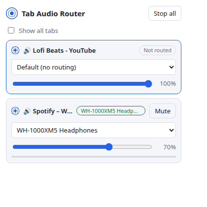

<p align="center"></p>

<h1 align="center">Tab Audio Router</h1>

<p align="center">

[](https://github.com/Zxce3/tab-audio-router/releases)
[](LICENSE)

</p>

🔊 A Chrome (Manifest V3) extension that sends **each tab's audio to a different output device**, so one tab can play on your speakers while another plays on your headphones or Bluetooth device.

<p align="center"></p>

## ✨ Features

- 🎧 Pick an output device per tab
- 🔈 Per-tab volume (with %) and mute
- 📊 Live level meter per routed tab
- 🔎 Tab search and first-run onboarding
- ♿ Keyboard focus styles and ARIA labels, light/dark theme
- 📌 Current tab highlighted and listed first; optional **Show all tabs**
- 🔢 Toolbar badge shows how many tabs are routed; **Stop all** button
- 🔌 Falls back to the default output if a routed device is unplugged
- 🧠 Remembers the last device used per site (shown as a hint)

## 📦 Install

**From a release (recommended)**
1. Download `tab-audio-router-vX.Y.Z.zip` from [Releases](https://github.com/Zxce3/tab-audio-router/releases) and unzip it.
2. Open `chrome://extensions` and enable **Developer mode**.
3. Click **Load unpacked** and select the unzipped folder.

**From source**
```sh
git clone https://github.com/Zxce3/tab-audio-router.git
```
Then load the folder with **Load unpacked** as above.

## 🎛️ Usage

1. Click the extension icon and press **Grant device access** (once). This only reveals output device names; the microphone is never recorded.
2. Open the popup **on the tab you want to route**, then choose an output device.
3. Repeat on other tabs with different devices. Routing stays active when you switch tabs.
4. Choose **Default (no routing)** or **Stop all** to restore normal output.

## ⚙️ How it works

`tabCapture` stream id → offscreen document → `AudioContext({ sinkId })` → chosen device.
Capturing a tab mutes its normal output, so routed audio plays only on the device you pick.

| File | Role |
| --- | --- |
| `background.js` | Service worker: brokers requests, manages the offscreen document and badge |
| `offscreen.js` | Captures tab streams and plays them through the selected sink |
| `popup.html` / `popup.css` / `popup.js` | Per-tab device, volume, mute and level meter UI |
| `permission.html` / `permission.js` | One-time device-name permission page |

## ⚠️ Limitations

- Requires Chrome 116+ (`AudioContext` `sinkId` support).
- Chrome only lets `tabCapture` start on a tab you've just invoked the extension on, so open the popup on a tab to start routing it.
- Routed tabs are muted on their normal output by design.
- Chrome-only; other Chromium browsers may work but are untested.

## 📄 License

[MIT](LICENSE)
